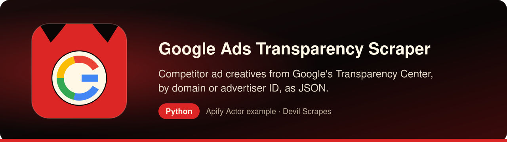

<p align="center"><a href="https://apify.com/DevilScrapes/google-ads-transparency"></a></p>

# Google Ads Transparency Scraper in Python: competitor ad creatives into pandas

<p align="center">
<a href="https://apify.com/DevilScrapes/google-ads-transparency"></a>

<a href="LICENSE"></a>
<a href="https://github.com/devilscrapes/google-ads-transparency-scraper-python/actions/workflows/ci.yml"></a>
</p>

This repository is a compact, tested Python client for the **[Google Ads Transparency Scraper](https://apify.com/DevilScrapes/google-ads-transparency)** on Apify. You hand it a brand's website domain, or the advertiser ID Google assigns to the account behind the ads, and it brings back a table of every creative the Transparency Center lists for that target in your date window. Each row names the advertiser, links to the creative, says which domain the ad clicks through to, and records when Google first and last showed it. Collection happens on Apify; locally you get `results.json` and `results.csv`.

> **Actor:** [Google Ads Transparency Scraper — Advertiser Ad Library Export](https://apify.com/DevilScrapes/google-ads-transparency) · **Publisher:** [Devil Scrapes](https://apify.com/DevilScrapes) · **Also in JavaScript:** [google-ads-transparency-scraper-javascript](https://github.com/devilscrapes/google-ads-transparency-scraper-javascript)

## 🔥 What you get

- **Two ways to name a target**: a landing domain such as `nike.com`, or an advertiser ID starting with `AR` when you already know exactly which account you want. Both lists can go into the same run.
- **A creative appears once per run**: when two of your targets surface the same `creative_id`, the repeat is dropped before it is written or billed.
- **Fetching stops at your budget**: with `maxResults` set to 10, the Actor requests pages only until ten creatives are in hand rather than paging to the end and discarding the rest.
- **Screening mode for long domain lists**: set `screeningMode` to `true` and each target collapses into a single summary row with an ad count, the earliest and latest dates seen and one sample creative link.
- **Base fee only after Google replies**: the $0.20 start event is charged once a search gets an answer, even an answer with zero ads. A run that never gets one ends FAILED and costs nothing.
- **Failures stay local**: a refused first page is retried with backoff on a new proxy session, a failure on a later page keeps the creatives already collected, and a target that still fails is skipped while the rest finish.

## 🎯 Use cases

### Measure how long a rival keeps a creative alive

Subtract `first_shown_ts` from `last_shown_ts` and you have a rough lifespan for each ad. Advertisers rarely keep paying for creatives that lose money, so the ones that stay live for months are usually the ones worth studying before you brief your own designers.

### Benchmark creative volume across a category

Put five competing domains in `searchDomains`, run once, and group by `advertiser_name` in a notebook. The count of distinct creatives and the split between text, image and video formats give a quick picture of who is testing hard and who runs the same three ads all year.

### Find unexpected advertisers pointing at your domain

Search your own domain and compare `advertiser_name` and `advertiser_id` with the accounts you know you operate. An unfamiliar advertiser sending clicks to your site is worth a look by the brand protection or affiliate compliance team.

### Keep a weekly archive for later analysis

Point a cron entry at `python main.py --out archive/$(date +%F)` once a week. Concatenating the dated folders later gives you a history of launches and retirements per advertiser that the Transparency Center interface does not let you download.

## ⚡ Quick start

You need an Apify account and an API token from [Console → Settings → Integrations](https://console.apify.com/settings/integrations). Apify's free plan includes monthly usage credit; this Actor's event prices are listed under Pricing below.

```bash
git clone https://github.com/devilscrapes/google-ads-transparency-scraper-python.git
cd google-ads-transparency-scraper-python
python -m venv .venv && source .venv/bin/activate
pip install -r requirements.txt
export APIFY_TOKEN=your_token_here
python main.py                      # uses input.json
python main.py my-input.json --out data --max-charge 2
```

The script starts the [Google Ads Transparency Scraper — Advertiser Ad Library Export](https://apify.com/DevilScrapes/google-ads-transparency), waits for it to finish, prints a link to the run in Apify Console and saves every result to `results.json` and `results.csv`. It exits with code 1 and the run's status message if the run fails.

## 🧩 The core call

Without the command-line wrapper, everything comes down to one client object, one blocking call and a loop over the dataset.

```python
from apify_client import ApifyClient

client = ApifyClient("YOUR_APIFY_TOKEN")
run = client.actor("DevilScrapes/google-ads-transparency").call(run_input={'searchDomains': ['nike.com'], 'maxResults': 10, 'maxPages': 1, 'proxyConfiguration': {'useApifyProxy': True}})
for item in client.dataset(run.default_dataset_id).iterate_items():
    print(item)
```

## 📥 Input

`main.py` forwards `input.json` exactly as written. The sample looks up one domain, reads a single page from Google and keeps at most ten creatives, so a first run finishes quickly and costs a few cents. Add `dateFrom` and `dateTo` in `YYYY-MM-DD` form to narrow the window; without them the Actor looks back 365 days from today in UTC.

```json
{
  "searchDomains": [
    "nike.com"
  ],
  "maxResults": 10,
  "maxPages": 1,
  "proxyConfiguration": {
    "useApifyProxy": true
  }
}
```

| Field | Type | Required | Default | Allowed values |
|---|---|---|---|---|
| `searchDomains` | array | no | `["nike.com"]` | — |
| `advertiserIds` | array | no | `[]` | — |
| `region` | string | no | `"anywhere"` | `anywhere`, `AE`, `AR`, `AT`, `AU`, `BE`, `BG`, `BR`, `CA`, `CH`, `CL`, `CO`, `CZ`, `DE`, `DK`, `EE`, `EG`, `ES`, `FI`, `FR`, `GB`, `GR`, `HU`, `ID`, `IE`, `IL`, `IN`, `IT`, `JP`, `KR`, `LT`, `LV`, `MX`, `MY`, `NL`, `NO`, `NZ`, `PH`, `PL`, `PT`, `RO`, `SA`, `SE`, `SG`, `SK`, `TH`, `TR`, `UA`, `US`, `VN`, `ZA` |
| `dateFrom` | string | no | — | — |
| `dateTo` | string | no | — | — |
| `maxResults` | integer | no | `1000` | — |
| `maxPages` | integer | no | `25` | — |
| `proxyConfiguration` | object | no | `{"useApifyProxy": true}` | — |
| `screeningMode` | boolean | no | `false` | — |

## 📤 Output

In the default mode a row stands for one ad creative. Dates arrive as Unix seconds, which pandas converts with `unit="s"`. `format_type` is Google's numeric code rather than a label, and `region` simply echoes the region you passed, because Google's search does not filter on it. Rows from screening mode fill `domain`, `has_ads_detected`, `ad_count` and the other summary columns instead.

| Field | Type | Always present |
|---|---|---|
| `advertiser_id` | string | no |
| `advertiser_name` | string | no |
| `creative_id` | string | no |
| `creative_url` | string | no |
| `landing_domain` | string | no |
| `format_type` | integer or null | no |
| `first_shown_ts` | integer or null | no |
| `last_shown_ts` | integer or null | no |
| `impressions` | integer or null | no |
| `preview_image_url` | string or null | no |
| `preview_content_js_url` | string or null | no |
| `region` | string | no |
| `scraped_at` | string | no |
| `domain` | string or null | no |
| `has_ads_detected` | boolean or null | no |
| `ad_count` | integer or null | no |
| `first_seen_ts` | integer or null | no |
| `last_seen_ts` | integer or null | no |
| `sample_creative_url` | string or null | no |

## 💰 Pricing

| Event | Price (USD) |
|---|---|
| Actor start | $0.2 |
| Ad creative scraped | $0.003 |

Prices as configured on 2026-10-16. The [Actor page](https://apify.com/DevilScrapes/google-ads-transparency) always shows the current price. Runs are billed to the Apify account that owns the token. Use `--max-charge` to cap what a single run can cost.

## 🛠️ Working with the data in Python

The pandas script below (`pip install pandas`) converts both timestamps into datetimes, works out how many days each creative ran, summarises every advertiser and writes the ten longest-running ads to `long_runners.csv`. The format labels follow the 1, 2, 3 mapping described above, which is inferred rather than documented by Google.

```python
import json

import pandas as pd

ads = pd.DataFrame(json.load(open("results.json", encoding="utf-8")))
for col in ("first_shown_ts", "last_shown_ts"):
    ads[col.replace("_ts", "")] = pd.to_datetime(ads[col], unit="s", utc=True)
ads["days_live"] = (ads["last_shown"] - ads["first_shown"]).dt.days
ads["format"] = ads["format_type"].map({1: "text", 2: "image", 3: "video"}).fillna("other")

summary = ads.groupby("advertiser_name").agg(
    creatives=("creative_id", "nunique"),
    median_days_live=("days_live", "median"),
    newest_start=("first_shown", "max"),
)
print(summary.sort_values("creatives", ascending=False).to_string())
print(pd.crosstab(ads["advertiser_name"], ads["format"]).to_string())

veterans = ads.sort_values("days_live", ascending=False).head(10)
veterans[["advertiser_name", "creative_id", "days_live", "creative_url"]].to_csv("long_runners.csv", index=False)
```

## ❓ FAQ

### Does Google offer an official API for the Ads Transparency Center?

Google does not publish one for this data. The Actor gives you a programmatic route with nothing more than an Apify token, so a notebook or a scheduled job can query advertisers without anyone opening the Transparency Center site.

### Can I restrict results to one country?

Not through this Actor. Google's search returns the same creatives whatever region is requested, so `region` is stored on each row as a label for your own bookkeeping and does not narrow the data.

### Why do some rows have no `preview_image_url`?

Only static image creatives come with a direct image link. Video and animated creatives carry `preview_content_js_url` instead, a script Google uses to render the preview, so plan on separate handling for those rows in your analysis.

### How do I check a few hundred domains without paying for every ad?

Turn on `screeningMode`. Each domain then produces one summary row, charged as one result, with `has_ads_detected` and `ad_count`. Note that the count only covers creatives fetched within `maxPages` and `maxResults`, so treat it as a lower bound.

## 🧯 Troubleshooting

- **`Set APIFY_TOKEN first`**: export the token in the same shell, or put it in a local `.env` file your shell loads. Never commit it.
- **Run finished with `FAILED` or `ABORTED`**: open the printed Console link; the run log says why. Input validation errors name the field.
- **Fewer rows than expected**: a `--max-charge` cap also limits how many results can be charged. Raise the cap or lower the limits in your input.
- **Something looks wrong in the data**: open an issue on the [Actor page](https://apify.com/DevilScrapes/google-ads-transparency) so the maintainers see it.

## 🔗 More from Devil Scrapes

- [Google Ads Transparency Scraper — Advertiser Ad Library Export on Apify Store](https://apify.com/DevilScrapes/google-ads-transparency)
- [JavaScript version of this example](https://github.com/devilscrapes/google-ads-transparency-scraper-javascript)
- [All Devil Scrapes Actors](https://apify.com/DevilScrapes)
- [Apify web scraping cookbook](https://github.com/devilscrapes/apify-web-scraping-cookbook)

Related Actors:

- [Meta Ad Library Scraper — Ad Search & Export](https://apify.com/DevilScrapes/meta-ad-library-scraper) — the same competitor question asked of Facebook and Instagram ads.
- [TikTok Ad Library Scraper](https://apify.com/DevilScrapes/tiktok-ad-library-scraper) — ads from TikTok's commercial content library.
- [Apple Ad Repository Scraper](https://apify.com/DevilScrapes/apple-ad-repository-scraper) — App Store search ads from Apple's ad repository.

---

MIT licensed example code. The Actor itself runs on [Apify](https://apify.com/DevilScrapes/google-ads-transparency) and is maintained by [Devil Scrapes](https://apify.com/DevilScrapes). Not affiliated with Google or Alphabet.
